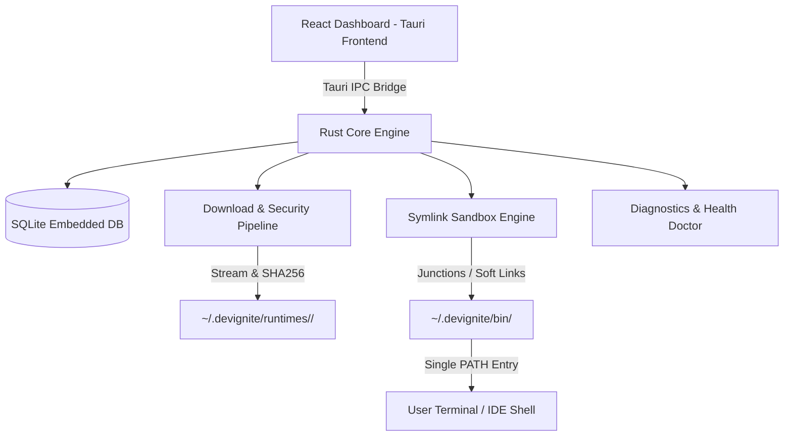

# DevIgnite Architecture Specification

DevIgnite is a high-performance, cross-platform developer environment manager engineered to install, orchestrate, and switch between programming language runtimes (Node.js, Python, Rust, Go) via a sandboxed symlink routing engine without polluting the global OS `PATH`.

---

## 1. High-Level Architecture Overview

DevIgnite decouples runtime storage from binary discovery by routing all active executables through a single directory added to the user's `PATH`.



---

## 2. Directory Hierarchy

```text
~/.devignite/
├── devignite.db            # Embedded SQLite tracking metadata & active runtimes
├── bin/                    # Active symlinks/junctions exposed to user PATH
│   ├── node.exe -> ~/.devignite/runtimes/node/20.11.0/node.exe
│   ├── npm.exe  -> ~/.devignite/runtimes/node/20.11.0/npm.exe
│   └── python.exe -> ~/.devignite/runtimes/python/3.12.1/python.exe
├── cache/                  # Downloaded archive cache (.zip, .tar.gz, etc.)
└── runtimes/               # Immutable unpacked runtime storage
    ├── node/
    │   ├── 18.19.0/
    │   └── 20.11.0/
    ├── python/
    │   └── 3.12.1/
    ├── go/
    │   └── 1.22.0/
    └── rust/
        └── 1.76.0/
```

---

## 3. Subsystem Breakdown

### 3.1 Sandboxed Symlink Engine (`src-tauri/src/sandbox/`)
- **Windows Implementation**: Employs native NTFS directory junctions and soft symlinks. Automatically falls back to directory junctions if developer mode or elevated permissions are unavailable.
- **Unix Implementation**: Employs POSIX-compliant atomic relative/absolute symbolic links.
- **OS PATH Injection**:
  - Windows: Writes `~/.devignite/bin` to `HKEY_CURRENT_USER\Environment\Path` and broadcasts `WM_SETTINGCHANGE` across `HWND_BROADCAST`.
  - Unix: Inspects `.zshrc`, `.bashrc`, and `.config/fish/config.fish` to prepend `~/.devignite/bin`.

### 3.2 Security & Download Pipeline (`src-tauri/src/installer/`)
- **Streaming Verification**: Incoming byte streams are piped through `sha2::Sha256` digest calculators while emitting progress metrics to Tauri IPC.
- **Zip-Slip Mitigation**: Archive extractors validate every destination path against the base sandbox directory, rejecting entries containing `..` or leading directory separators.

### 3.3 DevIgnite Doctor (`src-tauri/src/doctor/`)
- Detects dangling/orphaned symlinks in `~/.devignite/bin/`.
- Scans `PATH` for conflicting global runtime binaries (e.g. `C:\Program Files\nodejs`).
- Validates read/write/execute permissions across `~/.devignite/`.
- Offers programmatic auto-fix remediations.

### 3.4 State Management & Database (`src-tauri/src/db/`)
Tracks runtime metadata, SHA256 checksums, and activation flags in an embedded SQLite database using `rusqlite`.
